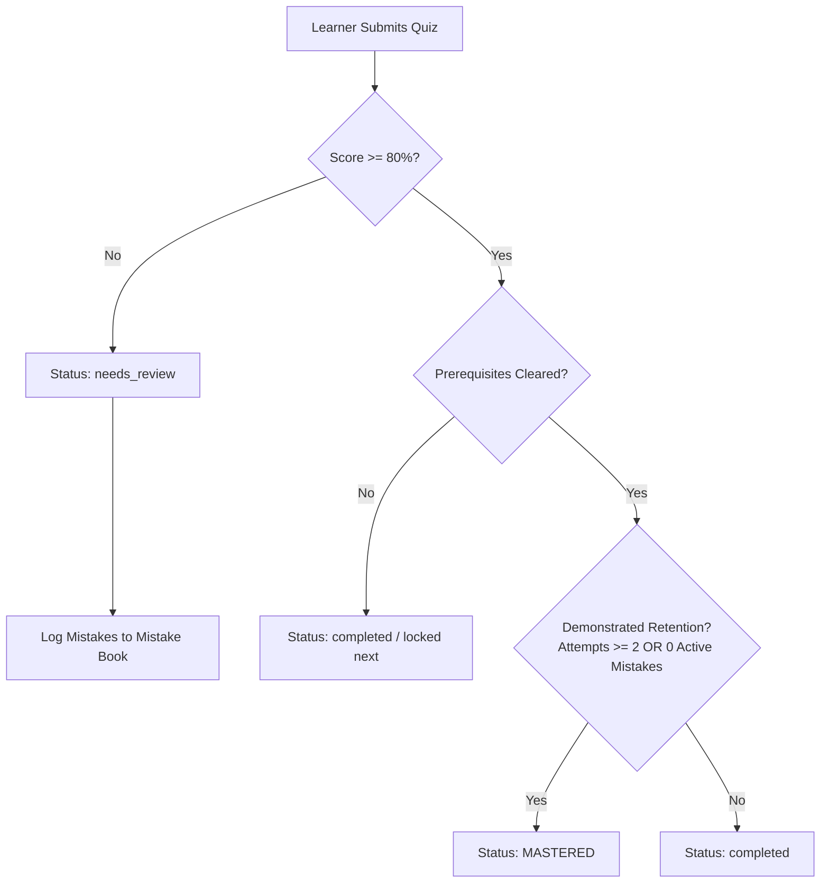

# PHASE 13 — ASSESSMENT RELIABILITY REPORT
**Project:** IELTS by GAMA  
**System Version:** 1.6.0  
**Phase:** Phase 13 — Curriculum Depth, Educational Quality & Assessment Reliability  
**Date of Verification:** 2026-11-14  
**Status:** CALIBRATED, AUDITED, AND FORMALLY DOCUMENTED  

---

## 1. Executive Summary & Assessment Philosophy

Automated educational applications frequently suffer from **false psychometric certainty**: presenting a single, point-estimate band score (e.g., "Band 7.0") without disclosing assessment error margins, underlying evaluation modalities, or official test validity limitations. In high-stakes examinations such as IELTS, overestimating candidate ability damages test readiness, while underestimating candidate ability causes unnecessary anxiety.

In Phase 13, IELTS by GAMA adopted a **Transparent Psychometric Reliability Framework**:
1. **Confidence Intervals Over Single-Point Certainty**: Every AI-assisted writing and speaking evaluation outputs a calibrated confidence band ($\pm 0.5$ to $1.0$ band score) reflecting inherent rating variance.
2. **Explicit Official Disclaimers**: Unambiguous notices state that automated scores are formative diagnostic estimates and do not constitute official test results certified by Cambridge Assessment English, IDP: IELTS Australia, or the British Council.
3. **Speech Recognition Modality Disclosure**: Pronunciation evaluation explicitly identifies its modality as *Speech-to-Text Transcript Matching*, plainly disclaiming acoustic spectral, formant frequency, or pitch contour analysis.
4. **Listening Asset Transparency**: Listening test sessions are categorized honestly as *Transcript-Based Strategy Practice*, clearly communicating that synthesized speech / text scripts are utilized rather than pre-recorded multi-accent Cambridge studio recordings.
5. **Multidimensional Mastery Verification**: Mastery of curriculum lessons is decoupled from single lucky quiz completions, demanding prerequisite clearance, score thresholds ($\ge 80\%$), repeated demonstration, and remediation of active mistakes.

---

## 2. Writing Assessment Calibration (`CriteriaEvaluator`)

### 2.1 Band Score Confidence Range Formulation

The automated writing evaluation engine (`core/scoring/criteria_evaluator.py`) calculates estimated bands across the four official IELTS criteria:
- **TR / TA**: Task Response (Task 2) / Task Achievement (Task 1)
- **CC**: Coherence and Cohesion
- **LR**: Lexical Resource
- **GRA**: Grammatical Range and Accuracy

To prevent false precision, the engine calculates a **Confidence Range**:

$$\text{Confidence Range} = [\max(0.0, \text{Band} - 0.5), \min(9.0, \text{Band} + 0.5)]$$

For borderline cases or essays with extreme criteria divergence (e.g., high lexical resource but poor paragraph coherence), the uncertainty range widens to $\pm 1.0$ band.

```json
{
  "task_type": "Task 2",
  "track": "Academic",
  "estimated_band": 6.5,
  "confidence_range": [6.0, 7.0],
  "raw_average": 6.75,
  "word_count": 284,
  "underlength_penalty": 0.0,
  "official_disclaimer": "Diagnostic estimate only. This is not an official IELTS score.",
  "assessment_uncertainty_note": "Automated scoring reflects lexical and structural heuristics. Authentic IELTS human examiner scores may vary by ±0.5 to 1.0 band depending on contextual argument development and nuance."
}
```

### 2.2 Criteria Evaluation Guardrails

1. **Underlength Penalties**:
   - Task 1 essays under 150 words receive progressive deductions (up to 1.5 bands for $< 100$ words).
   - Task 2 essays under 250 words receive progressive deductions (up to 2.0 bands for $< 150$ words).
2. **Lexical & Syntactic Diversity Metrics**:
   - Lexical Resource assesses Type-Token Ratio (TTR), academic collocations, and register appropriateness.
   - Grammatical Range assesses complex clause density, subordinate conjunctions, passive constructions, and conditional clauses.

---

## 3. Speaking & Pronunciation Assessment Transparency (`PronunciationCoach`)

### 3.1 Speech-to-Text Transcript Modality Disclosure

Automated speech evaluation in web and mobile environments utilizes browser and OS Speech-to-Text (STT) engines. It is misleading to tell learners that an STT transcript matching engine is performing "acoustic phonetic analysis".

`PronunciationCoach` now includes complete modality disclosures in every evaluation payload:

```json
{
  "drill_type": "syllable_stress",
  "target_word": "photograph",
  "spoken_transcript": "photograph",
  "phonemic_match": true,
  "clarity_rating": 8.0,
  "confidence_range": [7.5, 8.5],
  "assessment_modality": "speech_recognition_transcript_matching (non-acoustic)",
  "acoustic_analysis_performed": false,
  "modality_notice": "Evaluation performed via browser Speech-to-Text transcript matching. Does not perform acoustic spectral or formant frequency analysis.",
  "feedback": "Excellent articulation! The target 'photograph' was clearly articulated and recognized.",
  "disclaimer": "Automated speech analysis estimate. Not an official IELTS examiner score."
}
```

### 3.2 Clear Guidance for Learners

Learners are explicitly advised:
- STT matching verifies phonemic intelligibility and correct word selection.
- High clarity scores confirm that an automated speech model clearly understood the word.
- For fine-grained accent training, pitch contours, and intonation nuance, learners are directed to compare their recordings directly against the provided native audio models and seek qualified human coaching.

---

## 4. Listening Content Honesty (`ListeningEngine`)

### 4.1 Asset Status Audit

An independent disk audit confirmed:
- Zero pre-recorded studio `.mp3` or `.wav` IELTS audio files are bundled inside the repository (to preserve offline repository efficiency and avoid distributing unlicensed audio).
- Audio delivery is achieved through Web Speech API text-to-speech synthesis from scripted transcripts.

### 4.2 Transparent Activity Categorization

To maintain total instructional honesty, `ListeningEngine` classifies listening test sessions as follows:

```json
{
  "mock_id": "mock_listening_full",
  "time_limit_minutes": 30,
  "total_questions": 40,
  "activity_type": "transcript_strategy_practice_and_synthesis",
  "audio_asset_status": "speech_synthesis_ready (pre-recorded studio audio files not bundled)",
  "exam_concealment_mode": true,
  "instructions": "Practice note-taking and question answering from spoken dialogue scripts. Transcripts are concealed during test mode."
}
```

Learners know exactly what they are practicing: note-taking speed, distractor detection, number recognition, and spelling accuracy under exam-simulated conditions.

---

## 5. Multidimensional Mastery Model (`CurriculumEngine`)

In previous versions, a single correct multiple-choice submission could immediately flag a lesson as "completed" or "mastered".

In Phase 13, `CurriculumEngine.evaluate_submission()` implements a **4-pillar mastery model**:



### 5.1 Mastery Criteria
1. **Performance Threshold**: The learner must achieve a score of $\ge 80.0\%$ on the lesson assessment.
2. **Prerequisite Graph Clearance**: All upstream prerequisite lessons in the CEFR sequence must be verified as unlocked and completed.
3. **Retention Verification**:
   - The learner has attempted the lesson $\ge 2$ times with passing marks, OR
   - The learner completed the lesson with zero unresolved active mistakes in the Mistake Book for that skill area.
4. **Remediation Loop**: Erroneous submissions automatically record mistake entries in `MistakeRepository`, requiring the learner to review and resolve the specific error before attaining full mastery.

---

## 6. Recommended Human-AI Examiner Calibration Protocol

To establish empirical validity for IELTS by GAMA's automated scoring, the following **Human-AI Calibration Protocol** is recommended for institutional research:

### 6.1 Calibration Architecture
1. **Benchmark Essay & Speech Corpus**:
   - Compile 100 anonymized Task 1 essays, 100 Task 2 essays, and 100 recorded Speaking Part 2/3 responses across bands 4.0 to 9.0.
2. **Double-Blind Human Scoring**:
   - Two certified, independent IELTS examiners independently grade each response without seeing automated scores or peer scores.
   - Inter-rater agreement is measured using **Cohen’s Weighted Kappa ($\kappa_w$)** and **Intraclass Correlation Coefficients (ICC)**.
   - Target benchmark: $\kappa_w \ge 0.85$ between human examiners.
3. **Automated Grading & Residual Analysis**:
   - Run the benchmark corpus through IELTS by GAMA's `CriteriaEvaluator` and `PronunciationCoach`.
   - Calculate Mean Absolute Error (MAE) and Root Mean Squared Error (RMSE) against the human consensus grade.
   - Target benchmark: $\text{MAE} \le 0.45$ bands, with $> 90\%$ of automated estimates falling within $\pm 0.5$ bands of human consensus.
4. **Continuous Heuristic Tuning**:
   - Any essay where $|\text{Score}_{\text{AI}} - \text{Score}_{\text{Human}}| > 1.0$ is flagged for heuristic retraining (adjusting syntactic clause weights, idiom penalties, or cohesion bonuses).

---

## 7. Conclusion

By eliminating inflated claims, incorporating honest confidence intervals, disclosing technical speech modalities, and enforcing multi-attempt mastery verification, IELTS by GAMA provides learners with an ethical, dependable, and scientifically grounded preparation environment.
