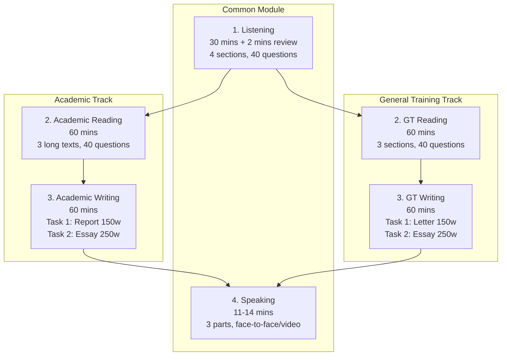

# PHASE 14 — IELTS EXAMINATION FORMAT REFERENCE
**Project:** IELTS by GAMA  
**System Version:** 1.6.0  
**Phase:** Phase 14 — Full IELTS Examination Simulation & End-to-End Validation  
**Date of Verification:** 2026-11-14  
**Authoritative Sources Consulted:**
- **IELTS.org Official Test Format:** https://www.ielts.org/for-test-takers/test-format
- **British Council Take IELTS Guide:** https://takeielts.britishcouncil.org/take-ielts/prepare/test-format
- **IDP IELTS Test Format Specifications:** https://ielts.idp.com/about/test-format
- **Cambridge Assessment English IELTS Handbook:** https://www.cambridgeenglish.org/exams-and-tests/ielts/test-format/

---

## 1. Global Examination Overview

The International English Language Testing System (IELTS) assesses language proficiency across four macro-skills: Listening, Reading, Writing, and Speaking. The test is offered in two distinct tracks:
- **IELTS Academic**: For candidates seeking higher education enrollment or professional registration in English-speaking environments.
- **IELTS General Training**: For candidates seeking secondary education, vocational training, work experience, or migration to Australia, Canada, New Zealand, and the UK.

---

## 2. Skill-by-Skill Verified Specifications

### 2.1 Listening (Academic & General Training Identical)
- **Duration**: ~30 minutes audio playback + 2 minutes review time (computer-delivered) or 10 minutes transfer time (paper-based).
- **Format**: 4 recorded sections played **once only**.
  - **Section 1**: Conversation between two speakers set in an everyday social context (e.g. reserving accommodation, booking transport).
  - **Section 2**: Monologue set in an everyday social context (e.g. speech about local facilities, guide explaining a museum layout).
  - **Section 3**: Conversation between up to four people in an educational or training context (e.g. university tutor and student discussing an assignment).
  - **Section 4**: Monologue on an academic subject (e.g. university lecture on biology or architecture).
- **Questions**: Exactly 40 questions (10 per section). 1 mark per correct answer.
- **Question Types**: Form/note/table/flow-chart/summary completion, multiple choice, short-answer questions, sentence completion, matching, plan/map/diagram labeling.
- **Scoring Reference**: 39-40 correct $\rightarrow$ Band 9.0; 35-36 $\rightarrow$ Band 8.0; 30-31 $\rightarrow$ Band 7.0; 23-25 $\rightarrow$ Band 6.0; 16-17 $\rightarrow$ Band 5.0.

### 2.2 Reading
- **Duration**: Exactly 60 minutes (no transfer time; all answers must be entered within 60 minutes).
- **Questions**: Exactly 40 questions across 3 sections. 1 mark per correct answer.

#### 2.2.1 Academic Reading
- **Text Structure**: 3 long texts (approx. 700–900 words each, totaling 2,150–2,750 words).
- **Sources**: Books, journals, magazines, newspapers written for a non-specialist audience on topics of general academic interest. Texts range from descriptive/factual to discursive/analytical.
- **Scoring Reference**: 39-40 correct $\rightarrow$ Band 9.0; 35-36 $\rightarrow$ Band 8.0; 30-32 $\rightarrow$ Band 7.0; 23-26 $\rightarrow$ Band 6.0; 15-18 $\rightarrow$ Band 5.0.

#### 2.2.2 General Training Reading
- **Text Structure**:
  - **Section 1 (Social Survival)**: 2–3 short factual texts related to everyday life in an English-speaking country (e.g. public notices, advertisements, timetables).
  - **Section 2 (Workplace Survival)**: 2 texts focusing on the work context (e.g. job descriptions, contracts, staff training, workplace policies).
  - **Section 3 (General Reading)**: 1 longer, more complex text on a topic of general interest (e.g. popular science, history, biography).
- **Scoring Reference**: 40 correct $\rightarrow$ Band 9.0; 37-38 $\rightarrow$ Band 8.0; 34-35 $\rightarrow$ Band 7.0; 30-31 $\rightarrow$ Band 6.0; 23-26 $\rightarrow$ Band 5.0. (GT requires higher raw accuracy for equivalent band scores).

#### 2.2.3 Common Reading Question Types
1. Multiple Choice (single or multiple answer)
2. Identifying Information (True / False / Not Given)
3. Identifying Writer's Views/Claims (Yes / No / Not Given)
4. Matching Information
5. Matching Headings
6. Matching Features
7. Matching Sentence Endings
8. Sentence Completion
9. Summary, Note, Table, Flow-chart Completion
10. Diagram Label Completion
11. Short-Answer Questions

### 2.3 Writing
- **Duration**: Exactly 60 minutes.
- **Task Weighting**: **Task 2 carries twice as much weight as Task 1** (Task 1 = 1/3, Task 2 = 2/3 of the Writing band score). Recommended time allocation: 20 minutes for Task 1; 40 minutes for Task 2.

#### 2.3.1 Task 1
- **Academic Task 1**: Candidates are presented with visual information (a graph, chart, table, diagram, process, or map) and must describe, summarize, or explain the main features in their own words in at least **150 words**.
- **General Training Task 1**: Candidates are presented with a situation and must write a letter requesting information or explaining the situation (personal/informal, semi-formal, or formal) addressing three bullet points in at least **150 words**.
- **Evaluation Criteria**: Task Achievement (TA), Coherence & Cohesion (CC), Lexical Resource (LR), Grammatical Range & Accuracy (GRA).

#### 2.3.2 Task 2 (Academic & General Training)
- **Task 2**: Candidates write a formal discursive essay of at least **250 words** responding to a point of view, argument, or problem.
- **Essay Types**: Opinion (Agree/Disagree), Discussion (Both Views + Opinion), Advantages vs Disadvantages, Causes & Solutions / Causes & Effects, Two-Part Direct Questions.
- **Evaluation Criteria**: Task Response (TR), Coherence & Cohesion (CC), Lexical Resource (LR), Grammatical Range & Accuracy (GRA).

### 2.4 Speaking (Academic & General Training Identical)
- **Duration**: 11–14 minutes.
- **Structure**:
  - **Part 1 (Introduction & Interview)**: 4–5 minutes. Examiner introduces themselves, confirms identity, and asks general questions on familiar topics (home, family, work, studies, interests).
  - **Part 2 (Individual Long Turn)**: 3–4 minutes. Candidate receives a task card (cue card) with a topic and 3–4 guidance prompts. Candidate is given **exactly 1 minute of preparation time** (pencil and paper provided for notes), followed by **1 to 2 minutes of continuous speaking**, concluding with 1–2 brief follow-up questions from the examiner.
  - **Part 3 (Two-way Discussion)**: 4–5 minutes. The examiner asks broader, abstract questions connected to the topic of Part 2, requiring the candidate to analyze, speculate, evaluate, and justify opinions.
- **Evaluation Criteria**: Fluency and Coherence (FC), Lexical Resource (LR), Grammatical Range and Accuracy (GRA), Pronunciation (PR).

---

## 3. Computer-Delivered IELTS Simulation Standards

In accordance with official Computer-Delivered IELTS specifications:
1. **Screen Layout**:
   - Split-view interface: Passage/Prompt on the left (or top on mobile); questions and input fields on the right (or bottom).
   - Independent scrolling for reading text and question lists.
2. **Timer Architecture**:
   - Continuous visual countdown timer in header.
   - High-contrast visual notifications when 10 minutes and 5 minutes remain.
   - Automatic submission on timer expiration.
3. **Question Navigation Palette**:
   - Interactive item numbers for all questions (e.g. 1–40).
   - Clear visual status: **Unanswered** (default), **Answered** (highlighted), and **Flagged for Review** (marked with banner/marker).
4. **Examination Security**:
   - Answers, transcripts, and model keys must remain strictly concealed on the server and never sent in pre-submission API payloads.
   - Accidental page navigation or refresh must trigger immediate recovery without losing answered inputs or resetting elapsed examination time.
